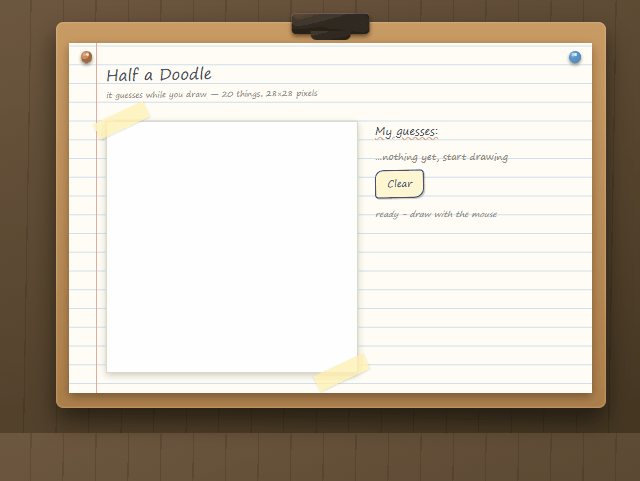

# Half a Doodle

> **Draw something in the browser and a lightweight neural network guesses what it is in real-time as you draw.**  
> It runs completely client-side in your browser using ONNX Runtime Web, meaning zero server latency, no cloud APIs, and complete privacy. It also includes an optional local vision model that narrates your sketches beside the predictions.



[](LICENSE)
[](https://www.python.org/)
[](https://onnxruntime.ai/)
[](https://ollama.com)

---

## Features

- **Zero-Latency Client-Side Inference**: Runs a custom 20-class convolutional neural network directly inside your web browser through [ONNX Runtime Web](https://onnxruntime.ai/). No drawing data ever leaves your computer.
- **Handmade School-Project Interface**: Designed to resemble a classroom ruled notebook page pinned to a wooden clipboard, complete with binder holes, masking tape, and highlighter-style prediction meters.
- **Prefix Recognition for Partial Drawings**: Trained intentionally on unfinished sketches. The classifier begins identifying subjects accurately when a drawing is only 30% complete.
- **Optional Live Narration via Ollama**: Hooks into any locally installed vision-language model (such as `moondream` or `qwen2.5-vl` through [Ollama](https://ollama.com)) to narrate your drawing onto a sticky note as you sketch.
- **Dual-Model Collaboration**: When the classifier is confident (at least 60%), its top prediction is passed to the vision model prompt, transforming generic shape descriptions into context-aware descriptions.
- **Strict Bit-Parity Verification**: Features an automatic parity check (`parity.json`) on page load that verifies the browser JavaScript rasterizer produces the exact same pixel values as the Python training code.

---

## Quick Start

### Option A: One-Click Launch (Windows)

Double-click start.bat (or launch.bat), or run in your terminal:

`cmd
start.bat
`

This automated script will:
- Check for Python and start the local static server on port 8000.
- Detect if Ollama is installed and start it in the background with proper CORS settings.
- Automatically open your default browser to http://localhost:8000/index.html.

To cleanly close the app and all running dependencies, double-click stop.bat (or close.bat):

`cmd
stop.bat
`

*(Run stop.bat --all if you also want to force-close any independently started Ollama instance).*

---

### Option B: Manual Launch (Linux / macOS / Windows)

`ash
# 1. Clone the repository
git clone https://github.com/ShubhamPandeycreate/Half-a-Doodle.git
cd Half-a-Doodle

# 2. Start a local static file server
python -m http.server 8000
# (If python is not recognized, try: python3 -m http.server 8000)

# 3. Open http://localhost:8000/index.html in your browser
`

> **Why a local server is necessary:** Modern browsers restrict WebAssembly and model files like `model.onnx` from loading directly over `file://` URLs due to local security policies.

---

## Optional: Live Vision Narrator (Ollama)

If you want a second opinion on what you are drawing, you can run a vision model locally using [Ollama](https://ollama.com).

```
+-------------------------------------------------------------+
|                       Browser Canvas                        |
+------------------------------+------------------------------+
               | (28x28 normalized)            | (full canvas image)
               v                               v
       +---------------+               +---------------+
       |   ONNX CNN    |               | Ollama (VLM)  |
       | (Client-side) |               | (Local GPU)   |
       +-------+-------+               +-------+-------+
               | "bicycle: 98%"                |
               +--------------> primes prompt -+
                                       |
                                       v
                       "A doodle of a bicycle with
                        two distinct circular wheels"
```

### Setup in Two Steps:

1. **Install and start [Ollama](https://ollama.com)**
2. **Download a vision model** (`moondream` is recommended because it is fast enough to update every couple of seconds):
   ```bash
   ollama pull moondream
   ```

3. **Turn on the "narrate" switch** on the yellow sticky note in the interface.

### Supported Vision Models

The application checks `http://localhost:11434` automatically and detects installed vision models:

| Model | Download Size | Notes |
| :--- | :--- | :--- |
| **`moondream`** *(Default)* | ~1.7 GB | The fastest option (around one second per caption). Ideal for real-time sketching. |
| **`granite3.2-vision`** | ~2.4 GB | Fast and responsive, with strong performance on diagrams and outlines. |
| **`llava-phi3`** | ~2.9 GB | Generates descriptive, well-structured sentences. |
| **`qwen2.5vl:3b`** | ~3.2 GB | Excellent at interpreting line art, though slightly slower. |
| **`llava:7b`** | ~4.7 GB | High capability; requires around 5 GB of VRAM and takes a few seconds per update. |

You can switch models in the dropdown menu or specify one directly in the URL: `http://localhost:8000/index.html?vlm=moondream`.

> **Resolving CORS Issues:** Ollama allows connections from `localhost` by default. If your browser reports a cross-origin request block, set the origin variable when starting Ollama:
> ```bash
> # Linux or macOS
> OLLAMA_ORIGINS="http://localhost:8000" ollama serve
>
> # Windows (PowerShell)
> $env:OLLAMA_ORIGINS="http://localhost:8000"; ollama serve
> ```

---

## Why This Approach Works

Most sketch classifiers perform well on completed test sets but fall apart during interactive use, often guessing a single class until the very last stroke.

This project addresses three common pitfalls in real-time drawing recognition:

1. **Training on Partial Sketches (Prefix Sampling)**:  
   Standard datasets only include completed drawings. During training, `data.py` randomly slices early prefixes of stroke sequences ($f \in [0.15, 1.0]$). This trains the model to recognize beginnings and midpoints of sketches instead of waiting for finished outlines.

2. **Identical Dual-Language Rasterization**:  
   The Python rasterizer used in training and the JavaScript rasterizer used in the browser must output the exact same 28x28 pixel grid byte for byte. Subtle differences in antialiasing, stroke width, or rounding create substantial performance loss.  
   - Both implementations use uniform half-up rounding: `floor(v + 0.5)`
   - Both use box downsampling: `(sum + 32) / 64`
   - Both are verified on page load against the precomputed vectors in `parity.json`.

3. **Dynamic Bounding Box Normalization**:  
   During a live session, the final dimensions of the sketch are unknown. Training normalizes partial strokes according to their immediate bounding box at that point in time, matching how the browser scales drawing progress.

---

## Vocabulary

The model recognizes 20 specific items from Google's [Quick, Draw!](https://quickdraw.withgoogle.com/data) dataset:

| Category | Classes |
| :--- | :--- |
| **Vehicles and Travel** | `airplane`, `bicycle` |
| **Food and Drink** | `apple`, `banana`, `cup` |
| **Animals and Nature** | `butterfly`, `cat`, `fish`, `flower`, `tree`, `cloud`, `moon`, `star` |
| **Household and Objects** | `book`, `chair`, `clock`, `eye`, `guitar`, `house`, `key` |

Drawing anything outside these 20 classes will result in the model choosing the closest match among the categories it knows.

---

## Architecture and Evaluation

- **Network Architecture**: Four convolutional layers with Batch Normalization, ReLU activations, and Max Pooling ($28 \times 28 \to 14 \times 14 \to 7 \times 7$).
- **Classification Head**: Spatial features flattened through Dropout ($p=0.3$) into a 20-class linear output layer.
- **Export Format**: Standard ONNX model (`model.onnx`, ~300 KB) expecting raw pixel values from 0 to 255.

### Evaluation on Unseen Test Sketches

| Drawing Completion | Top-1 Accuracy | Top-3 Accuracy |
| :--- | :---: | :---: |
| **Finished Sketches (100%)** | **~93%** | **~98%** |
| **Early Sketches (~30% complete)** | **~54%** | **~80%** |

---

## Retraining the Model

To download the training data and train the model yourself:

```bash
# 1. Install dependencies
pip install torch numpy onnx onnxscript

# 2. Download 5,000 samples per class from Quick, Draw! (~100,000 drawings total)
python data.py

# 3. Train the model and export to ONNX
python train.py
```

`train.py` tracks accuracy on both completed and partial drawings each epoch, exporting the final weights directly to `model.onnx`.

---

## Repository Structure

```text
├── start.bat        # One-click launcher (starts server + Ollama + opens browser)
├── stop.bat         # One-click terminator (cleanly shuts down app and dependencies)
├── launch.bat       # Shortcut alias for start.bat
├── close.bat        # Shortcut alias for stop.bat
├── index.html       # Web application containing canvas, JS rasterizer, and inference logic
├── model.onnx       # Pre-trained ONNX model (~300 KB)
├── parity.json      # Reference drawings used to verify JS rasterizer parity on page load
├── data.py          # Dataset download script, stroke prefix sampler, and Python rasterizer
├── train.py         # PyTorch training script and ONNX exporter
├── assets/
│   └── demo.gif     # Demo animation
├── LICENSE          # MIT License
└── README.md        # Documentation
```

---

## License

Distributed under the MIT License. See [`LICENSE`](LICENSE) for details.
